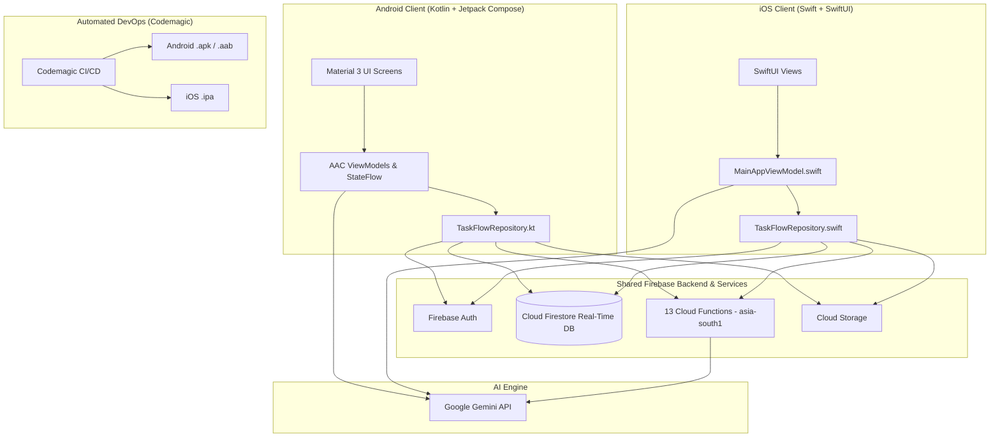

# TaskFlow AI — Enterprise Task & Team Management Platform

<div align="center">

[](https://developer.android.com/)
[](https://developer.apple.com/ios/)
[](https://kotlinlang.org/)
[](https://developer.apple.com/swift/)
[](https://developer.android.com/jetpack/compose)
[](https://developer.apple.com/xcode/swiftui/)
[](https://firebase.google.com/)
[](https://ai.google.dev/)
[](https://codemagic.io/)

<p align="center">
  <b>A state-of-the-art enterprise-grade dual-native mobile solution (Android Kotlin/Compose + iOS Swift/SwiftUI) combining real-time multi-device cloud synchronization, strict multi-tier role isolation, AI-powered workflow automation, dynamic time tracking, and automated CI/CD builds.</b>
</p>

</div>

---

## 📖 Table of Contents

- [Overview](#-overview)
- [Key Features](#-key-features)
- [Dual-Platform Architecture & Tech Stack](#-dual-platform-architecture--tech-stack)
- [Repository Structure](#-repository-structure)
- [Prerequisites](#-prerequisites)
- [Getting Started & Local Setup](#-getting-started--local-setup)
- [Firebase Backend Configuration](#-firebase-backend-configuration)
- [Codemagic CI/CD Pipelines (Android & iOS)](#-codemagic-cicd-pipelines-android--ios)
- [Security & Compliance](#-security--compliance)
- [Testing & Quality Assurance](#-testing--quality-assurance)
- [Author & Maintenance](#-author--maintenance)

---

## 🌟 Overview

**TaskFlow AI** is built for modern distributed teams and enterprise operations. It eliminates communication silos and administrative overhead by unifying project tracking, task execution, role-based governance, and real-time team communication into a single, cohesive experience.

Built with **two independent native applications connecting to the exact same Firebase backend**:
- **Android:** Native Kotlin + Jetpack Compose (Material 3).
- **iOS:** Native Swift + SwiftUI (iOS 16+).

TaskFlow delivers immediate real-time sync across devices with zero lag or duplicate entries.

---

## ⚡ Key Features

### 1. 🛡️ Role-Isolated Multi-Tier Workspaces
- **Organization Owner / Admin Dashboard:** Complete bird's-eye view of organizational pipeline, company-wide deliverable statuses, member rosters, manager approvals, and immutable audit logs.
- **Department Manager Dashboard:** Department-scoped deliverables, approval workflows, workload metrics, and interactive priority bottleneck charts.
- **Staff Associate Dashboard:** Focused, distraction-free view showing only tasks assigned to the current member.

### 2. 🤖 Gemini AI Workflow Assistant
- Direct bottom-navigation AI assistant powered by Google Gemini.
- Automatically breaks complex deliverables into actionable subtasks, drafts operational summaries, and suggests priority tags.

### 3. ⏱️ Dynamic Time Log Tracker & Stopwatch
- Built directly into task details with live `Start Timer` and `Stop & Log` controls (`00:00:00`).
- Seamlessly converts elapsed sessions into fractional billable hours.
- Quick-log incremental presets (`+15m`, `+30m`, `+1h`, `+2h`).

### 4. 👥 Team Directory, Workgroups & Group Chat
- Organization admins can configure cross-functional workgroups with **1–2 lead managers (enforced max 2)** and staff associates.
- Dedicated real-time group chat modal with role badges, sender avatars, audible notifications, and immediate sync.

### 5. 📊 Interactive Visual Analytics
- Integrated D3.js Priority Donut Chart in the Manager view displaying real-time priority distribution (Urgent, High, Medium, Low) and bottleneck risk assessments.

### 6. 📝 Completion Notes & Verification
- Mandatory completion modal requiring execution notes (e.g., invoice numbers, filing IDs) and completion timestamps before marking tasks complete.
- Visual completion badges and audit timestamps visible to managers and admins.

### 7. 🔔 Audible Reminders & Alerts
- In-app notification banners combined with native device chime (`AudioManager.STREAM_NOTIFICATION` on Android / `AudioServicesPlaySystemSound` on iOS) for high-priority task alerts.

### 8. 📜 Statutory Compliance & GSTIN Verification
- Immutable administrative compliance ledger verifying mandatory business details (GSTIN verification and checksum checks).

---

## 🏗️ Dual-Platform Architecture & Tech Stack



| Layer | Android Native | iOS Native |
|---|---|---|
| **Language** | Kotlin 2.0.21, Java 17 | Swift 5.9 |
| **UI Framework** | Jetpack Compose (Material 3) | SwiftUI (iOS 16+) |
| **State Management** | StateFlow, Coroutines, ViewModel | ObservableObject, @Published, Combine |
| **Biometrics** | AndroidX BiometricPrompt | LocalAuthentication (Face ID / Touch ID) |
| **Secure Keypad** | Custom Compose 4-digit PIN | Custom SwiftUI 4-digit PIN Keypad |
| **Local Storage** | Encrypted SharedPreferences | Apple Keychain Services |
| **Shared Backend** | Firebase Auth, Firestore, Storage, Cloud Functions (Node 20, region `asia-south1`) |
| **AI Integration** | Google Gemini Generative AI | Google Gemini via Secure Backend Functions |
| **CI/CD** | Gradle assembleDebug/Release/Bundle | Xcodebuild archive & export signed IPA |

---

## 📁 Repository Structure

```
TaskFlow-AI---Application/
├── app/                               # Native Android application module (UNTOUCHED)
│   ├── src/main/java/                 # Kotlin source code
│   │   └── com/example/
│   │       ├── data/                  # Firebase data repositories & models
│   │       ├── ui/                    # Jetpack Compose UI screens & components
│   │       │   ├── auth/              # Login, registration, role selection
│   │       │   ├── dashboard/         # Owner, Manager, and Staff dashboards
│   │       │   ├── tasks/             # Task pipelines, modals, timers, filters
│   │       │   ├── team/              # Workgroups, team directory, group chat
│   │       │   ├── settings/          # Security, MPIN, GSTIN verification
│   │       │   └── theme/             # Material 3 colors, typography, theme
│   │       └── viewmodel/             # StateFlow ViewModels
│   ├── src/main/res/                  # Android resources, drawables, launcher icons
│   ├── google-services.json           # Firebase Android client configuration
│   └── build.gradle.kts               # App-level dependencies & plugins
├── ios/                               # Native iOS application module (NEW)
│   ├── TaskFlowAI.xcodeproj/          # Valid Xcode project & scheme configuration
│   │   ├── project.pbxproj
│   │   └── xcshareddata/xcschemes/TaskFlowAI.xcscheme
│   ├── TaskFlowAI/
│   │   ├── App/                       # TaskFlowAIApp.swift (@main) & AppState
│   │   ├── Models/                    # TaskFlowModels.swift (1:1 with Kotlin models)
│   │   ├── Services/                  # BackendApi.swift, AuthenticationManager.swift, TaskFlowRepository.swift
│   │   ├── Components/                # TaskFlowBrandLogo, D3PriorityDonutChart, StopwatchTimerView
│   │   ├── ViewModels/                # MainAppViewModel.swift (ObservableObject)
│   │   ├── Screens/
│   │   │   ├── Auth/                  # AuthView (3 Portals), PinEntryView (Face ID / PIN)
│   │   │   ├── Dashboard/             # MainDashboardView, Owner, Manager, Staff dashboards
│   │   │   ├── Tasks/                 # TaskPipelineView, TaskDetailModal, TaskCompletionModal
│   │   │   ├── Team/                  # TeamDirectoryView, CreateWorkgroupModal, GroupChatModal
│   │   │   ├── Calendar/              # OperationalCalendarView
│   │   │   ├── AI/                    # AiAssistantView (Gemini Chat)
│   │   │   ├── Activity/              # ActivityAuditView (Operational Feed & Compliance)
│   │   │   └── Settings/              # SettingsView (GSTIN, MPIN, Session Revocation)
│   │   └── Resources/                 # Assets.xcassets, Info.plist, GoogleService-Info.plist
│   └── Package.swift                  # Swift Package Manager manifest with Firebase iOS SDK
├── codemagic.yaml                     # Codemagic CI/CD build configuration (Android & iOS)
├── CODEMAGIC_README.md                # Dedicated CI/CD build & release guide
├── docs/                              # Comprehensive architectural specifications
├── functions/                         # Firebase Cloud Functions (13 functions, Node.js 20)
├── gradle/                            # Gradle wrapper & version catalogs
└── build.gradle.kts                   # Root build configuration
```

---

## 💻 Prerequisites

- **Android Development:** [Android Studio](https://developer.android.com/studio) (JDK 17 or 21).
- **iOS Development:** macOS with [Xcode 15+](https://developer.apple.com/xcode/) (iOS 16.0+ SDK).
- **Backend & Tools:** [Node.js](https://nodejs.org/) v20 LTS, [Firebase CLI](https://firebase.google.com/docs/cli).

---

## 🚀 Getting Started & Local Setup

### 1. Android Setup
```bash
# Open the root repository folder in Android Studio
# Run Gradle sync and execute on Android emulator or physical device
./gradlew assembleDebug
```

### 2. iOS Setup
```bash
# Open the Xcode project in macOS
cd ios
open TaskFlowAI.xcodeproj
# Or resolve package dependencies:
xcodebuild -resolvePackageDependencies -project TaskFlowAI.xcodeproj
```

---

## 📦 Codemagic CI/CD Pipelines (Android & iOS)

This repository includes a production-ready `codemagic.yaml` for independent automated builds.

### Android Workflow (`android-workflow`)
Produces:
- **`app-debug.apk`** (Direct sideload testing)
- **`app-release.apk`** (Production signed APK)
- **`app-release.aab`** (Google Play Store App Bundle)

### iOS Workflow (`ios-workflow`)
Produces:
- **`TaskFlowAI.ipa`** (Signed iOS application package for TestFlight / Ad-Hoc distribution)
- **`TaskFlowAI.xcarchive`** (Xcode build archive)

Refer to [CODEMAGIC_README.md](file:///c:/Users/asus/Downloads/taskflow-ai/CODEMAGIC_README.md) for signing setup and artifact download steps.

---

## 👤 Author & Maintenance

**TaskFlow AI**  
Developed and maintained by **[Ashish Chavan](https://github.com/ashishchavan1221)**  
GitHub: [@ashishchavan1221](https://github.com/ashishchavan1221)
